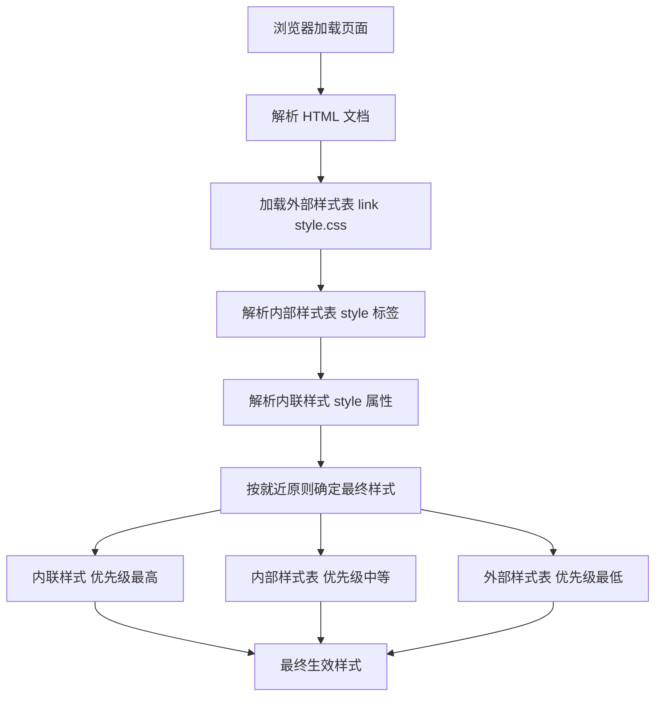

# CSS 基础：样式表、选择器与三大特性

> 原文：[CSDN](https://blog.csdn.net/qq_63283852/article/details/164404684)

## 一、CSS 基本概念与引入方式

### 1.1 什么是CSS

**CSS**（Cascading Style Sheets，层叠样式表）是一种用来控制网页在浏览器中显示外观的语言。

| 概念 | 说明 |
| --- | --- |
| **HTML** | 结构，用于展示内容 |
| **CSS** | 样式，用于设置网页的样式及布局 |
| **核心思想** | 结构与样式分离 |

### 1.2 CSS的核心作用

CSS的核心是**控制视觉表现**，主要包括三个方面：

1. **样式美化**：文本样式、背景、边框等
2. **布局与定位**：元素排列、响应式设计
3. **动画交互**：伪类、过渡、动画

### 1.3 CSS3现状

- CSS3已被大部分现代浏览器支持
- CSS4仍在开发中

#### 修改后的 HTML 代码（含外部样式表）

下面这份 HTML 代码同时演示了三种 CSS 引入方式：内联样式、内部样式表和外部样式表。

通俗来说呢，内联是直接写在 HTML 元素的 **`style` 属性**内，**作用于当前这一个具体的 HTML 元素**，无法复用。

而内部样式表写在当前 HTML 文档 `<head>` 标签内的 **`<style>` 标签**中。**仅作用于当前的这一个 HTML 文档。**（以下的笔记均通过这种方式整理）

**外部样式表（External Styles）**存放在独立的 **`.css`** 文件中，通过 `<head>` 内的 `<link rel="stylesheet" href="...">` 标签引入。只要任意 HTML 文件通过 `<link>` 引入该 CSS 文件，即可复用全部样式，是前端开发的基石。

```html
<!DOCTYPE html>
<html lang="zh-CN">
<head>
    <meta charset="UTF-8">
    <meta name="viewport" content="width=device-width, initial-scale=1.0">
    <title>CSS三种引入方式</title>
    <!-- 3. 外部样式表（推荐） -->
    <link rel="stylesheet" href="style.css">
    <!-- 2. 内部样式表（写到head中的style标签里） -->
    <style>
        div {
            color: blue;
            font-size: 20px;
        }
    </style>
</head>
<body>
    <!-- 1. 内联样式表（行内样式），直接在标签的style属性中写CSS -->
    <p style="color: pink; font-size: 18px;">喵喵喵（内联样式）</p>
    <!-- 内部样式表生效 -->
    <div>喵喵喵（内部样式）</div>
    <!-- 外部样式表生效（需要在style.css中定义） -->
    <span>喵喵喵（外部样式）</span>
</body>
</html>
```

---

#### 创建外部样式表文件 `style.css`

在同一个文件夹下新建 `style.css` 文件，写入以下内容：

```css
/* style.css - 外部样式表 */
span {
    color: green;
    font-weight: bold;
    font-size: 24px;
}
/* 也可以同时设置其他标签，但会被内联/内部覆盖（优先级规则） */
div {
    color: orange;  /* 会被内部样式表的 blue 覆盖，因为内部样式在后面 */
}
```

下面逐行拆解这份 `style.css` 文件，看看每一部分到底在做什么：

#### 1. 注释行

```css
/* style.css - 外部样式表 */
```

以 `/*` 开头、`*/` 结尾的内容是 CSS 注释，浏览器会直接忽略，不会产生任何样式效果。这里只是给文件起个名字，方便自己和同事一眼看出这是哪个文件。

#### 2. 选择器 `span`

```css
span {
    color: green;
    font-weight: bold;
    font-size: 24px;
}
```

这里的 `span` 是**类型选择器（标签选择器）**，意思是：选中页面中**所有** `<span>` 标签，并给它们统一应用大括号里的三条样式：

- `color: green;` —— 文字颜色变成绿色
- `font-weight: bold;` —— 文字加粗
- `font-size: 24px;` —— 字号放大到 24 像素

回到前面那份 HTML 代码，正文里有一个 `<span>喵喵喵（外部样式）</span>`，它没有写任何内联样式，也没有被内部样式表覆盖，所以最终会命中这里，显示为**绿色、加粗、24px** 的文字。

#### 3. 选择器 `div`

```css
div {
    color: orange;  /* 会被内部样式表的 blue 覆盖，因为内部样式在后面 */
}
```

同理，`div` 会选中页面中**所有** `<div>` 标签，把它们的文字颜色设为橙色。

但注意：HTML 里的 `<div>喵喵喵（内部样式）</div>` 同时被**内部样式表**设置了 `color: blue`。根据前面总结的优先级规则，在权重相同的情况下，**后加载/后定义的样式会覆盖前面的**。内部样式表写在 `<head>` 中，而外部样式表通过 `<link>` 引入，浏览器按顺序加载，内部样式表在外部样式表之后生效，所以最终这个 `div` 显示为**蓝色**，而不是橙色。

#### 4. 小结：这份文件到底在做什么

| 选择器 | 作用对象 | 设置的样式 | 最终是否生效 |
| --- | --- | --- | --- |
| `span` | 所有 `<span>` 标签 | 绿色、加粗、24px | 生效（无其他样式覆盖） |
| `div` | 所有 `<div>` 标签 | 橙色 | 被内部样式表的蓝色覆盖 |

所以这份 `style.css` 的核心作用就是：**把「样式」从 HTML 里抽离出来，单独放到一个 .css 文件中统一管理**。HTML 只负责结构，CSS 负责外观，这就是「结构与样式分离」的体现，也是外部样式表成为主流做法的原因。

---

#### 三种样式表的优先级总结（权重相同的情况下）

| 引入方式 | 优先级（就近原则） |
| --- | --- |
| **内联样式**（行内） | 最高（权重 (1,0,0,0)） |
| **内部样式表**（`<style>`） | 中等（后定义覆盖先定义） |
| **外部样式表**（`.css` 文件） | 最低（但依然遵循层叠规则） |

> **注意**：当权重相同时，**后加载/后定义的样式会覆盖前面的**。内联样式权重最高，会覆盖内部和外部。

---

下面用一张流程图直观展示三种引入方式的加载顺序与优先级关系：



**就近原则的实际体现**：所谓「就近」，指的是样式声明距离目标元素越近，优先级越高。内联样式直接写在标签的 `style` 属性上，离元素最近，所以优先级最高；内部样式表写在 `<head>` 的 `<style>` 标签里，距离稍远；外部样式表通过 `<link>` 引入，距离最远，优先级最低。在权重相同的情况下，后加载的样式会覆盖先加载的样式，这也是「就近原则」的另一种体现——后定义的样式在时间上更「近」。实际开发中，我们通常只用外部样式表统一管理样式，避免内联样式和内部样式表造成优先级混乱，这正是对就近原则的合理规避。

#### 实际开发建议

- **外部样式表**是主流做法，便于复用和维护。
- 一个项目通常只使用一种引入方式（外部），这里展示三种是为了学习区别。

## 二、CSS选择器

选择器是CSS规则的第一部分，用于选择HTML元素。选择器选择标签，CSS属性修改样式。

Pasted image 20260903180812.png

### 2.1 基础选择器

基础选择器由单个选择器组成，是CSS中最基本的选择方式。

#### 2.1.1 类型选择器（标签选择器）

选择某个类型的元素。

```css
/* 选择所有span标签修改样式 */
span {
    color: green;
}
```

> **CSS层叠性**：CSS规则可以同时作用于一个元素，浏览器通过特定规则决定最终生效的样式。原则是**后定义的样式覆盖先前的样式**（就近原则）。

#### 2.1.2 类选择器

选择1个或多个元素，以 `.` 开头，实现差异性选择。

```css
/* CSS */
.nav {
    color: pink;
}
```

```html
<div class="nav">修改样式</div>
```

**使用规范：**

- 类名自定义，不能是中文或纯数字
- 多个英文单词组成尽量使用 `-` 链接
- 命名有重要意义，尽量见名知义
- class属性可以有多类名，中间用空格隔开

#### 2.1.3 ID选择器

选择HTML中具有特定id属性的**唯一**元素，以 `#` 开头。

```css
/* CSS */
#header {
    color: blue;
}
```

```html
<!-- HTML -->
<div id="header">修改样式</div>
```

> **注意**：同一页面中，id值必须唯一（不能重复），主要用于配合JavaScript添加交互效果。

#### 类选择器 vs ID选择器

| 对比项 | 类选择器 | ID选择器 |
| --- | --- | --- |
| 语法 | `.类名` | `#id名` |
| 作用 | 选择class属性的一个或多个元素 | 选择特定id属性的唯一元素 |
| 特点 | 可以使用多次 | 同一页面必须唯一 |
| 类似 | 身份证的名字 | 身份证的编号 |
| 场景 | 后期修改样式基本都是类选择器 | 配合JavaScript添加交互效果 |

#### 2.1.4 通配符选择器

选择HTML中所有的标签，用 `*` 表示。

```css
* {
    margin: 0;
    padding: 0;
}
```

> 特殊情况下通过通配符清除所有元素的默认边距和填充，统一不同浏览器的默认样式。但**性能较差，慎用**。

#### 2.1.5 基础选择器总结

| 选择器类型 | 语法示例 | 匹配范围 | 复用性 | 典型使用场景 | 注意事项 |
| --- | --- | --- | --- | --- | --- |
| 类型选择器 | `div {...}` | 某一类型标签 | 全局 | 标签样式重置 | 避免滥用，可能导致样式冲突 |
| 类选择器 | `.nav {...}` | 含指定class的元素 | 多次使用 | 多元素共享样式 | 优先使用 |
| ID选择器 | `#header {...}` | 唯一元素 | 唯一性 | 唯一元素标识 | 必须唯一 |
| 通配符选择器 | `* {...}` | 所有元素 | 全局覆盖 | 全局样式重置 | 性能较差，慎用 |

> **大部分情况下，我们使用类选择器，是最重要的。**

### 2.2 关系选择器

通过位置关系来选择目标元素，可以更精准选择某些元素。

#### 2.2.1 后代选择器

选择某个元素的后代元素（不限层级，包括子元素、孙元素等），用**空格**隔开。

```css
div p {
    color: pink;
}
/* 选择div标签里面的所有p元素 */
```

#### 2.2.2 子代选择器

选择某个元素的直接子元素（仅限一层），用 `>` 隔开。

```css
div > span {
    color: pink;
}
/* 选择div标签里面的第一层span元素 */
```

#### 2.2.3 兄弟选择器

**邻接兄弟选择器（+）**：选中紧跟在某元素后面的第一个同级元素。

```css
h2 + p {
    color: pink;
}
/* 选中紧跟在h2后面的第一个p元素 */
```

**通用兄弟选择器（~）**：选中某元素之后的所有同级元素。

```css
h2 ~ p {
    color: pink;
}
/* 选中紧跟在h2后面的所有p元素 */
```

#### 2.2.4 关系选择器总结

| 选择器 | 语法 | 选择范围 | 示例 |
| --- | --- | --- | --- |
| 后代选择器 | `A B` | 所有后代（跨层级） | `ul li {color: pink;}` |
| 子代选择器 | `A > B` | 直接子元素（仅一层） | `div > span {color: pink;}` |
| 邻接兄弟选择器 | `A + B` | 紧邻的下一个同级元素 | `h2 + p {}` |
| 通用兄弟选择器 | `A ~ B` | A之后的所有同级元素 | `h2 ~ p {}` |

> **后代选择器是最常用的。**

### 2.3 分组选择器（并集选择器）

将不同的选择器组合在一起，用**逗号**分割。

```css
div, span {
    color: pink;
}
```

**使用场景**：多个元素具备相同样式时，组合在一起避免重复代码。

### 2.4 伪类选择器

选择元素的特定状态或结构位置，符号是**冒号（:）**。

#### 2.4.1 状态伪类选择器

**链接伪类**（LVHA顺序）：

| 链接伪类 | 作用 |
| --- | --- |
| `a:link` | 未访问链接的默认样式 |
| `a:visited` | 已访问链接的样式 |
| `a:hover` | 鼠标悬停在链接上时的反馈 |
| `a:active` | 链接被点击时的瞬时状态 |

`:active` 的触发条件是：**鼠标左键按下 → 还没松开** 的这段时间。

> **伪类顺序规则**：`a:link` → `a:visited` → `a:hover` → `a:active`

**规则 1：四个伪类权重一样**

`a:link`、`a:visited`、`a:hover`、`a:active` 都是 (0,1,1)，分不出高下，只能靠**书写顺序**（后来者覆盖）。

**规则 2：状态会叠加，不是一个时刻只命中一个**

| 场景 | 同时命中的伪类 |
| --- | --- |
| 没访问过、鼠标悬停 | `:link` + `:hover` |
| 访问过、鼠标悬停 | `:visited` + `:hover` |
| 按住鼠标（必然悬停着） | `:hover` + `:active` |

**用户行为伪类（动态伪类）**：

| 动态伪类 | 作用 |
| --- | --- |
| `:hover` | 鼠标经过元素 |
| `:focus` | 获得焦点的元素（表单） |

#### 2.4.2 结构伪类选择器

根据元素的位置选择目标元素。

| 结构伪类 | 作用 |
| --- | --- |
| `:first-child` | 一组兄弟元素中的第一个元素 |
| `:last-child` | 一组兄弟元素中的最后一个元素 |
| `:nth-child(n)` | 一组兄弟元素列表中第n个元素 |

**n的取值可以是：**

- **数字**：从1开始
- **关键字**：`odd`（奇数）、`even`（偶数）
- **公式**：
  - `:nth-child(3n)` → 第3、6、9...个元素
  - `:nth-child(n+2)` → 第2个以及以后的元素
  - `:nth-child(-n+3)` → 前面3个元素

> 公式中n的取值从0开始计算。结构选择器每个语法权重相同，看顺序
>
> 两条规则的权重一模一样

| 规则 | 组成 | 权重 |
| --- | --- | --- |
| `.ul1 li:first-child` | 类 + 伪类 + 元素 | (0, 2, 1) |
| `.ul1 li:nth-child(2n+1)` | 类 + 伪类 + 元素 | (0, 2, 1) |

权重相同 → 按**书写顺序**，后面的覆盖前面的。

#### 2.4.3 表单伪类选择器

针对表单元素的状态，用于表单按钮禁用时调整颜色、复选框选中修改样式等场景。

### 2.5 伪元素选择器

选择元素的特定部分，使用**双冒号（::）**。

#### 2.5.1 选择特定部分

| 伪元素选择器 | 作用 |
| --- | --- |
| `::first-line` | 选择首行 |
| `::first-letter` | 选择首字母 |
| `::placeholder` | 选择input或textarea占位符 |

#### 2.5.2 插入内容

| 伪元素选择器 | 作用 |
| --- | --- |
| `::before` | 元素内插入伪元素，作为第一个元素 |
| `::after` | 元素内插入伪元素，作为最后一个元素 |

> **注意**：
>
> - `::before` 和 `::after` 插入的是伪元素，特性类似内联元素
> - `content` 属性**必须**，不能省略，没有内容用空引号即可
> - 后期非常常用

### 2.6 属性选择器

根据元素的属性特征来精准定位元素。

| 属性选择器 | 作用 |
| --- | --- |
| `[属性]` | 匹配包含指定属性的元素 |
| `[属性=值]` | 匹配属性值等于指定值的元素 |
| `[属性^=值]` | 匹配属性值以指定字符串开头的元素 |
| `[属性$=值]` | 匹配属性值以指定字符串结尾的元素 |
| `[属性*=值]` | 匹配属性值任意位置包含指定子串的元素 |
| `[属性名~="属性值"]` | 匹配属性值按空格拆成单词表，指定的值必须和其中某一个单词完全相等 |

**使用场景**：表单样式控制、图标字体控制、国际化语言适配等。

```css
/* /* 1.包含属性选择器：[属性名] */
    a[class] {
      color: red;
    }
    /* 2.属性值选择器：[属性名="属性值"]， */
    /* 匹配属性值等于指定值的元素 */
    a[class="font"] {
      color: blue;
    }
    /* 3.属性值选择器：[属性名~="属性值"]， */
    /* 匹配属性值按空格拆成单词表，指定的值必须和其中某一个单词完全相等 */
    a[class~="font"] {
      color: green;
    }
    /* 4.属性值选择器：[属性名^="属性值"]， */
    /* 匹配属性值以指定值开头的元素，如果只有这个属性值，不会被匹配 */
    a[class^="font"] {
      color: pink;
    }
    /* 5.属性值选择器：[属性名$="属性值"]， */
    /* 匹配属性值以指定值结尾的元素 */
    a[class$="14"] {
      color: yellow;
    }
    /* 6.属性值选择器：[属性名*="属性值"]， */
    /* 匹配属性值包含指定值的元素 */
    a[class*="14"] {
      color: orange;
    }
/* 去掉轮廓线 */
    input[type="text"],
    input[type="password"] {
      outline: none;
    }
  </style>
</head>
<body>
  <a href="#">修改文字颜色</a>

  <a href="#" class="font">修改文字颜色</a>

  <a href="#" class="font14">修改文字颜色</a>

  <a href="#" class="font16">修改文字颜色</a>

  <a href="#" class="red">修改文字颜色</a>

  <input type="text">
  <input type="password">
  <input type="checkbox">
  <input type="radio">
```

## 三、CSS三大特性

### 3.1 继承性

**子元素自动继承父元素的某些CSS样式属性。**

- 主要继承跟**文字相关**的样式属性：字体、颜色、文本对齐等
- 子元素定义自己的样式时，优先使用自己的样式

> **特殊情况**：`h` 标签默认加粗，`a` 标签默认有下划线，这些**不能通过继承性修改父级来实现取消**，需要单独指定样式。

### 3.2 层叠性

**如果权重相同的情况下，后面的样式会覆盖前面的样式**（就近原则）。

### 3.3 优先级

浏览器通过优先级来判断哪些属性值与一个元素最为相关。

**核心原则：**

1. 优先级相等时，CSS中最后声明的样式被应用（就近原则）
2. 权重高的选择器优先执行
3. 权重是4位一组，分开的层级，**不能进位**

| 选择器类型 | 示例 | 权重值 | 优先级说明 |
| --- | --- | --- | --- |
| `!important` | `color: red !important;` | 无限大 | 强制覆盖所有规则（慎用） |
| 内联样式 | `style="color: red"` | (1, 0, 0, 0) | 行内样式权重最高 |
| ID选择器 | `#myid` | (0, 1, 0, 0) | 每个ID增加权重 |
| 类/属性/伪类 | `.class`、`[type]`、`:hover` | (0, 0, 1, 0) | 每类增加权重 |
| 类型/伪元素 | `div`、`::after` | (0, 0, 0, 1) | 每标签/伪元素增加权重 |
| 通配符/继承 | `*`、继承的样式 | (0, 0, 0, 0) | 权重最低 |

> **权重叠加**：权重是累加的，每个选择器的层级权重相加。

## 四、CSS书写规范

### 4.1 书写规范

1. **选择器和大括号中间**保留1个空格距离
2. **属性名和属性值中间**保留1个空格
3. 每个CSS属性**单独占一行**（后期会打包压缩，无需担心体积问题）

### 4.2 CSS注释

- 快捷键：`Ctrl + /`
- 注释内容左右两侧保持一个空格距离是良好习惯

为什么csdn的ai助手这么霸道，直接就改。。。害的我撤回新写的发现什么都没了
