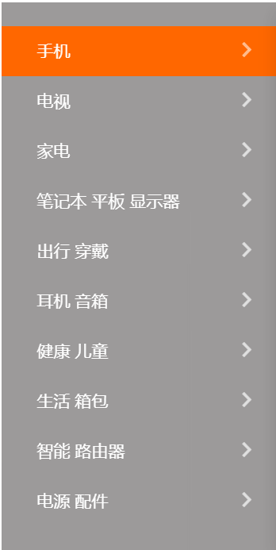
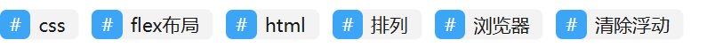
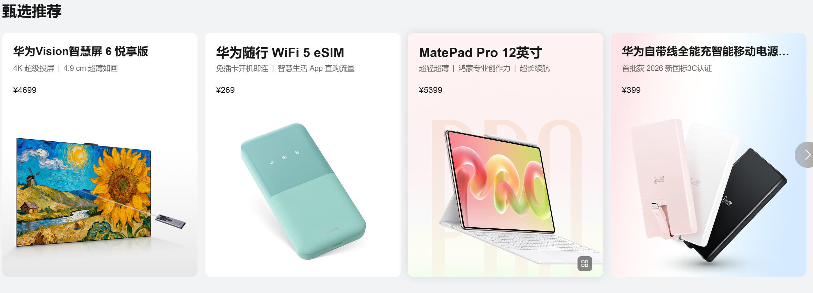

# 布局基础：display 模式转换

> 原文：[CSDN](https://blog.csdn.net/qq_63283852/article/details/164631871)

---

## 一、CSS 布局概述

CSS 布局是网页设计的核心技术之一，用于控制元素在页面中的排列方式。不同的布局技术各有优缺点，相互补充。在动手写样式之前，先了解浏览器默认的布局规则，再学会按需调整，往往能事半功倍。

#### 布局技术选型指南

| 场景 | 推荐技术 |
| --- | --- |
| **简单布局（一维）** | Flexbox |
| **简单布局（二维）** | Grid |
| **复杂响应式布局** | Grid + 媒体查询 |
| **文本内容分栏** | 多列布局（`column-count`） |
| **兼容旧浏览器** | 浮动布局或 Flexbox 降级方案 |
| **未来主流趋势** | CSS Grid 逐渐成为主流 |

## 二、CSS 正常布局流（Normal Flow）

**正常布局流**是指在不对页面进行任何布局控制时，浏览器默认的 HTML 布局方式，也称为**标准流**。它是 CSS 布局的基础，也是理解后续各种布局技巧的前提。

### 2.1 区块元素（Block）

| 特性 | 说明 |
| --- | --- |
| **独占一行** | 每个块级元素单独占一行，垂直排列 |
| **宽度** | 默认撑满父容器 100% |
| **宽高设置** | 可设置 `width` / `height` |
| **常见标签** | `<div>`、`<p>`、`<h1>`~`<h6>`、`<ul>`、`<ol>`、`<table>` |

### 2.2 行内元素（Inline）

| 特性 | 说明 |
| --- | --- |
| **不换行** | 水平方向依次排列，宽度不足时换行 |
| **宽度/高度** | 由内容决定，**无法直接设置** |
| **常见标签** | `<span>`、`<a>`、``、`<strong>`、`<em>` |

### 2.3 文档流方向

- 默认**从上到下**、**从左到右**排列

## 三、display 模式转换

了解了正常布局流之后，我们会发现它并不总能满足实际需求。正常流中的所有元素都有一个 `display` 属性，决定其默认的显示行为。但开发中常需要改变元素的默认行为：

- 让块级盒子**一行排列**
- 让行内元素**具备宽高**

### 3.1 display 常用属性值

| 属性值 | 是否独占一行 | 能否设置宽高 | 默认宽度 |
| --- | --- | --- | --- |
| `display: block;` | ✅ 是 | ✅ 可以 | 撑满父容器 |
| `display: inline;` | ❌ 否 | ❌ 不可以 | 由内容决定 |
| `display: inline-block;` | ❌ 否 | ✅ 可以 | 由内容决定（可覆盖） |

### 3.2 display: inline-block

**使用场景：**

1. 让块级盒子一行显示
2. 让行内盒子具备宽度和高度

**示例代码：**

```css
/* 将块级元素转为行内块，实现一行排列 */
li {
    display: inline-block;
    width: 100px;
    height: 50px;
}
```

### 3.3 行内块元素的空白缝隙问题

**现象**：行内块元素之间会出现**空白缝隙**（约 4px），原因是 HTML 代码中的**换行符和空格**被浏览器解析为文本节点。

**解决方案**：

```css
/* 给父元素设置 font-size: 0，消除空白字符的影响 */
.parent {
    font-size: 0;
}
/* 子元素重新设置字号 */
.parent li {
    font-size: 16px;
}
```
> **注意**：`display: inline-block` 适合对间距要求不高的场景。如需精细布局，我们可以使用 **Flexbox** 或 **Grid**来解决。

## 四、综合示例：三种布局的修改要点

前面介绍了 display 的几种常用模式，下面我们分别拆解三种典型布局，看看这些模式在实际项目中如何落地。

### 4.1 侧边导航栏（.subbar）—— 块级布局

**布局效果图**：



**布局特点**：这是一个典型的**垂直导航栏**，使用块级元素实现。每个链接独占一行，整行可点击。

**核心代码**：

```css
<div class="subbar">
    <ul>
        <li><a href="#">首页</a></li>
        <li><a href="#">课程</a></li>
        <li><a href="#">题库</a></li>
        <li><a href="#">社区</a></li>
    </ul>
</div>

<style>
    .subbar {
        width: 220px;              /* 固定导航栏宽度 */
        background-color: #2c3e50; /* 深色背景 */
        padding: 10px 0;
    }
    .subbar ul li a {
        display: block;            /* 关键：链接转块级，独占一行 */
        height: 44px;              /* 固定行高 */
        line-height: 44px;         /* 行高与高度一致，文字垂直居中 */
        color: #fff;
        padding-left: 24px;        /* 左侧留白，视觉更舒适 */
        text-decoration: none;
    }
    .subbar ul li a:hover {
        background-color: #e67e22; /* 悬停变橙色，提供交互反馈 */
    }
</style>
```

**修改要点**：

- **链接转块级**：`<a>` 默认是行内元素，无法设置宽高。通过 `display: block;` 转为块级，使其**独占一行**并**撑满父容器宽度**，整行可点击。
- **无需给 li 设置宽高**：因为目标整片都是 `<a>` 的范围，`<li>` 不需要单独设置宽高。当 `<a>` 变大时，会自动撑大 `<li>`。
- **a 转块后继承父容器宽度**：`<a>` 转为块级后，会继承父元素 `<li>` 的宽度（即撑满 `<li>` 的宽度），此时只需给 `<a>` 设置高度即可。

> **结论**：核心思路是让 `<a>` 转为块级并设置高度，`<li>` 会被自动撑开，无需额外设置宽高。

### 4.2 标签列表（.list）—— 行内块布局

**布局效果图**：



**布局特点**：这是一组**水平排列的标签按钮**，既要多个链接在一行显示，又要能设置宽高和内边距。

**核心代码**：

```css
<div class="list">
    <a href="#">前端</a>
    <a href="#">后端</a>
    <a href="#">算法</a>
    <a href="#">数据库</a>
</div>

<style>
    .list {
        width: 420px;
        border: 1px solid #ddd;
        padding: 10px;
    }
    .list a {
        display: inline-block;   /* 关键：转为行内块，水平排列且可设宽高 */
        height: 32px;
        line-height: 32px;
        background-color: #3498db; /* 蓝色标签背景 */
        color: #fff;
        border-radius: 16px;     /* 圆角胶囊外观 */
        font-size: 14px;
        margin: 6px;             /* 外边距产生间距，覆盖空白缝隙 */
        padding: 0 16px;
        text-decoration: none;
    }
</style>
```

**修改要点**：

- **链接转行内块**：`display: inline-block;` 让链接**水平排列**且**可设置宽高**。
- **圆角与背景**：`border-radius: 16px;` 和 `background-color: #3498db;` 让标签呈现胶囊按钮外观。

> **结论**：这种布局使用 `inline-block`，因为既要水平排列，又要设置宽高和内边距。由于设置了 `margin`，空白缝隙被间距覆盖，视觉上不明显。

### 4.3 图片盒子（.box）—— 行内块 + 空白缝隙处理

**布局效果图**：



**布局特点**：这是一组**水平排列的卡片盒子**，每个盒子固定宽高，适合展示图片或商品。

**核心代码**：

```css
<div class="box">
    <ul>
        <li>商品一</li>
        <li>商品二</li>
        <li>商品三</li>
        <li>商品四</li>
    </ul>
</div>

<style>
    .box {
        font-size: 0;            /* 关键：父元素字号归零，消除空白缝隙 */
    }
    .box li {
        display: inline-block;   /* 列表项转行内块，一行排列 */
        width: 180px;            /* 固定宽度 */
        height: 240px;           /* 固定高度 */
        background-color: #ecf0f1;
        border: 1px solid #bdc3c7;
        font-size: 14px;         /* 子元素重新设置字号，恢复文字显示 */
        text-align: center;
        line-height: 240px;      /* 让文字在盒子中垂直居中 */
    }
</style>
```

**修改要点**：

- **列表项转行内块**：`<li>` 默认是块级元素独占一行，通过 `display: inline-block;` 转为行内块，实现**一行排列**。
- **空白缝隙处理**：行内块之间默认有约 4px 缝隙，原因是 HTML 中的换行符和空格被解析为文本节点。给父元素 `.box` 设置 `font-size: 0;` 可消除缝隙。
- **子元素恢复字号**：父元素 `font-size: 0` 会导致文字消失，所以子元素 `.box li` 必须重新设置 `font-size: 14px;` 恢复文字显示。

**结论**：这种布局**必须**处理空白缝隙问题。`font-size: 0` 是常用技巧，但要注意子元素必须重新设置字号。如果对间距要求更精细，建议改用 **Flexbox** 或 **Grid**。

## 五、总结

布局没有银弹，关键在于理解每种模式的特性，再结合具体需求做出取舍：垂直导航用块级，水平标签用行内块，精细间距则交给 Flexbox 或 Grid。掌握这些基础，再遇到新的布局需求时，就能更快找到合适的方案。
