# Flex 弹性盒子布局

> 原文：[CSDN](https://blog.csdn.net/qq_63283852/article/details/164756426)

**摘要**：Flexbox是CSS一维布局模型，通过`display: flex`启用弹性容器，实现元素的对齐、分布与空间分配。核心概念包括主轴（Main Axis）与交叉轴（Cross Axis），由`flex-direction`控制方向。容器属性如`justify-content`（主轴对齐）、`align-items`（交叉轴对齐）、`flex-wrap`（换行）和`gap`（项目间距）可灵活控制布局。子项通过`flex`属性控制伸缩比例，`align-self`和`order`实现单独对齐与排序。配合`vertical-align`可解决图片底部空白问题，但在Flex/Grid布局中更推荐使用`align-items`实现垂直居中。

**目录**

[4.1 什么是 Flexbox？](#4%201%2020%20E4%20BB%2080%20E4%20B9%2088%20E6%2098%20AF%2020Flexbox%20EF%20BC%209F)

[4.2 Flexbox 的核心概念](#4%202%2020Flexbox%2020%20E7%209A%2084%20E6%20A0%20B8%20E5%20BF%2083%20E6%20A6%2082%20E5%20BF%20B5)

[（1）父控子（父子关系）](#EF%20BC%20881%20EF%20BC%2089%20E7%2088%20B6%20E6%208E%20A7%20E5%20AD%2090%20EF%20BC%2088%20E7%2088)

[（2）主轴（Main Axis）和交叉轴（Cross Axis）](#EF%20BC%20882%20EF%20BC%2089%20E4%20B8%20BB%20E8%20BD%20B4%20EF%20BC%2088Main%2020Axis%20EF%20BC%2089%20E5)

[4.3 容器（父盒子）属性](#4%203%2020%20E5%20AE%20B9%20E5%2099%20A8%20EF%20BC%2088%20E7%2088%20B6%20E7%209B%2092%20E5%20AD)

[4.3.1 display: flex —— 启用弹性盒子](#4%203%201%2020display%203A%2020flex%2020%20E2%2080%2094%20E2%2080%2094%2020%20E5%2090%20AF%20E7%2094%20A8)

[4.3.2 flex-direction —— 主轴方向](#4%203%202%2020flex-direction%2020%20E2%2080%2094%20E2%2080%2094%2020%20E4%20B8%20BB%20E8%20BD%20B4%20E6%2096)

[4.3.3 justify-content —— 主轴对齐方式](#4%203%203%2020justify-content%2020%20E2%2080%2094%20E2%2080%2094%2020%20E4%20B8%20BB%20E8%20BD%20B4%20E5%20AF)

[4.3.4 align-items —— 交叉轴对齐方式（单行）](#4%203%204%2020align-items%2020%20E2%2080%2094%20E2%2080%2094%2020%20E4%20BA%20A4%20E5%208F%2089%20E8%20BD)

[4.3.5 flex-wrap —— 是否换行](#4%203%205%2020flex-wrap%2020%20E2%2080%2094%20E2%2080%2094%2020%20E6%2098%20AF%20E5%2090%20A6%20E6%208D)

[4.3.6 align-content —— 多行交叉轴对齐](#4%203%206%2020align-content%2020%20E2%2080%2094%20E2%2080%2094%2020%20E5%20A4%209A%20E8%20A1%208C%20E4%20BA)

[4.4 项目（子盒子）属性](#4%204%2020%20E9%20A1%20B9%20E7%209B%20AE%20EF%20BC%2088%20E5%20AD%2090%20E7%209B%2092%20E5%20AD)

[4.4.1 flex —— 剩余空间分配](#4%204%201%2020flex%2020%20E2%2080%2094%20E2%2080%2094%2020%20E5%2089%20A9%20E4%20BD%2099%20E7%20A9)

[4.4.2 其他项目属性](#4%204%202%2020%20E5%2085%20B6%20E4%20BB%2096%20E9%20A1%20B9%20E7%209B%20AE%20E5%20B1%209E%20E6)

[4.5 gap 间距](#4%205%2020gap%2020%20E9%2097%20B4%20E8%20B7%209D)

[4.5.1 gap小结](#4%205%201%2020gap%20E5%20B0%208F%20E7%20BB%2093)

[五、垂直对齐（vertical-align）与图片底部空白缝隙](#4%206%2020Flex%2020%20E5%20AE%209E%20E6%2088%2098%20E6%20A0%20B8%20E5%20BF%2083%20E6%208A%2080%20E5)

[5.1 问题现象](#5%201%2020%20E9%2097%20AE%20E9%20A2%2098%20E7%208E%20B0%20E8%20B1%20A1)

[5.2 解决方案](#5%202%2020%20E8%20A7%20A3%20E5%2086%20B3%20E6%2096%20B9%20E6%20A1%2088)

[5.3 用 vertical-align 让文字和图片垂直居中](#5%203%2020%20E7%2094%20A8%2020vertical-align%2020%20E8%20AE%20A9%20E6%2096%2087%20E5%20AD%2097%20E5%2092%208C)

---

## 四、Flex 弹性布局

### 4.1 什么是 Flexbox？

**Flexbox** 是 CSS 弹性（伸缩）盒子布局模块（Flexible Box Layout Module）的缩写，是一种**一维布局模型**，可以快速实现元素的**对齐、分布和空间分配**。

### 4.2 Flexbox 的核心概念

#### （1）父控子（父子关系）

- **父盒子** → 称为**容器（Container）**
- **子盒子** → 称为**项目（Item）**
- **核心原则**：排列方式由父容器控制，伸缩尺寸可由子项各自设置

#### （2）主轴（Main Axis）和交叉轴（Cross Axis）

| 轴 | 默认方向 | 说明 |
| --- | --- | --- |
| **主轴（Main Axis）** | 水平方向（左 → 右） | 项目沿主轴排列 |
| **交叉轴（Cross Axis）** | 垂直方向（上 → 下） | 垂直于主轴的方向 |

> 主轴方向可通过 `flex-direction` 改变，交叉轴随之变化。

### 4.3 容器（父盒子）属性

#### 4.3.1 display: flex —— 启用弹性盒子

```css
.container {
    display: flex;  /* 块级弹性容器 */
    /* display: inline-flex; */  /* 行内弹性容器 */
}
```

**注意**：

- 父盒子（容器）设置为 `display: flex` 后，子盒子按**主轴**方向排列
- 主轴方向（宽度）由内容或宽度决定，有剩余空间时**不拉伸**；空间不足时按比例收缩（不小于内容最小宽度）。
- 子项无固定高度时会**拉伸填满容器高度**（交叉轴方向（高度）默认 `align-items: stretch`）。
- 若子元素总宽度超过容器宽度，默认会**压缩**子元素。

> 开发中大部分情况下，父容器设置 `display: flex`，子元素设定大小，保证画面正常展示。

**调试技巧**：在 Chrome/Edge 开发者工具（F12）中，flex 容器会显示紫色虚线高亮，方便调试。

#### 4.3.2 flex-direction —— 主轴方向

| 属性值 | 主轴方向 | 排列效果 |
| --- | --- | --- |
| `row`（默认） | 水平从左到右 | `A B C` |
| `row-reverse` | 水平从右到左 | `C B A` |
| `column` | 垂直从上到下 | `A` `B` `C` |
| `column-reverse` | 垂直从下到上 | `C` `B` `A` |

```css
.container {
    flex-direction: row;      /* 水平排列（默认） */
}
```

**案例：图标&文字按钮水平垂直居中**

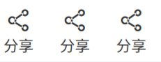

**需求：**让三个按钮走到盒子的中央，水平垂直居中。

**解决方法：**这里用 `flex-direction: column` 改变主轴方向，再配合 `justify-content` 和 `align-items` 实现。

**步骤 1：外层容器**（让三个按钮水平排列）

```css
.fenxiang {
    display: flex;   /* 让三个按钮水平排列，找到按钮父亲级类名设置 */
}
.fenxiang li {
    width: 60px;
    height: 80px;
    border: 1px solid red;
}
```

**步骤 2：核心居中**（图标和文字在按钮内水平垂直居中）

```css
.fenxiang li a {
    display: flex;
    flex-direction: column;   /* 主轴改垂直：图标在上、文字在下 */
    justify-content: center;  /* 主轴（垂直）居中 */
    align-items: center;      /* 交叉轴（水平）居中 */
    height: 100%;             /* 撑满 li，否则居中只在 a 自己的小盒子里生效 */
}
```

**步骤 4：HTML 结构**（三个按钮，结构一致）

```css
<ul class="fenxiang">
    <li><a href="#"><i class="iconfont icon-a-fenxiang2"></i><p>分享</p></a></li>
    <li><a href="#"><i class="iconfont icon-a-fenxiang2"></i><p>分享</p></a></li>
    <li><a href="#"><i class="iconfont icon-a-fenxiang2"></i><p>分享</p></a></li>
</ul>
```

**关键点解析**：

- `flex-direction: column` 负责把主轴改为垂直方向，图标和文字从上到下排列。
- `justify-content: center` 让内容在垂直方向（主轴）居中。
- `align-items: center` 让内容在水平方向（交叉轴）居中。

**为什么必须写 `height: 100%`？**

- 因为 `justify-content: center` 是相对元素**自己的盒子**居中的，而链接元素的盒子默认只有内容那么高，不会自动撑满所在的列表项。
- 如果不写 `height: 100%`：链接元素虽然设置了 `display: flex`，但它的高度默认是 `auto`（**由内容撑开**），也就是图标 30px 加上“分享”文字，大约 50 多 px；而父盒子列表项有 80px 高，于是链接元素这个 50px 的小盒子顶在列表项的上部，下方空出一截。
- `justify-content: center` 确实让图标和文字在链接元素内部垂直居中了，可链接元素自己位于 80px 空间的上半段，所以视觉上内容偏上，并未落在红框的正中心。
- 写了 `height: 100%` 后：链接元素的高度等于父元素列表项高度的 100%，即 80px，flex 容器的盒子和红框一样大了，`justify-content: center`（垂直方向）和 `align-items: center`（水平方向）才有完整的 80×60 空间来居中，图标和“分享”就真正落在红框的水平垂直中心

**为什么宽度不用写 `width: 100%`？**

- 因为 `display: flex` 会让链接元素变成**块级盒子**，块级盒子的宽度天生自动撑满父元素（60px 占满）。但块级盒子的高度天生是 `auto`（由内容决定），不会自动继承父高，所以高度必须手动写 `height: 100%` 去要。

> **注意**：改变主轴方向后，交叉轴自动跟随旋转。

#### 4.3.3 justify-content —— 主轴对齐方式

控制项目在**主轴**上的对齐方式（**整体分布**）。

| 属性值 | 效果说明 |
| --- | --- |
| `flex-start`（默认） | 左对齐（起点对齐） |
| `flex-end` | 右对齐（终点对齐） |
| `center` | 居中对齐 |
| `space-between` | **两端对齐**：首元素贴起点，末元素贴终点，中间均匀分布 |
| `space-around` | 每个项目两侧间隔**相等**（边缘间隔是中间的一半） |
| `space-evenly` | 所有间隔**完全相等**（包括边缘） |

**每种对齐方式的示例**：

**1. flex-start：左对齐（默认）**

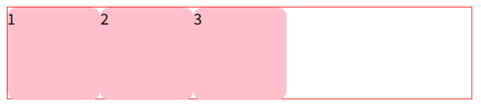

```css
.container {
    display: flex;
    justify-content: flex-start;
}
```

**2. flex-end：右对齐**

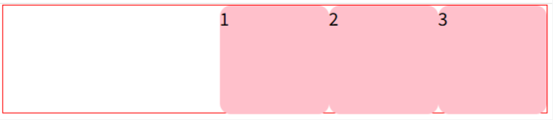

```css
.container {
    display: flex;
    justify-content: flex-end;
}
```

**3. center：居中对齐**

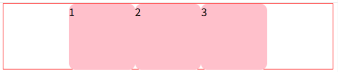

```css
.container {
    display: flex;
    justify-content: center;
}
```

**4. space-between：两端对齐**

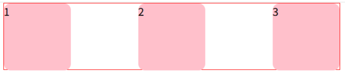

```css
.container {
    display: flex;
    justify-content: space-between;
}
```

**5. space-around：两侧间隔相等**

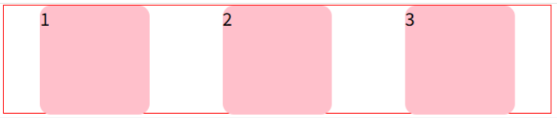

```css
.container {
    display: flex;
    justify-content: space-around;
}
```

**6. space-evenly：所有间隔完全相等**

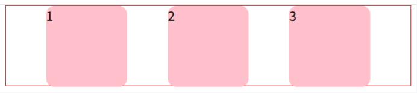

```css
.container {
    display: flex;
    justify-content: space-evenly;
}
```

#### 4.3.4 align-items —— 交叉轴对齐方式（单行）

控制项目在**交叉轴**上的对齐方式（**单行时整体对齐**）。

| 属性值 | 效果说明 |
| --- | --- |
| `flex-start` | 交叉轴起点对齐（顶部） |
| `flex-end` | 交叉轴终点对齐（底部） |
| `center` | 交叉轴居中对齐 |
| `stretch`（默认） | 拉伸填满整个容器（项目无固定高度时） |

**每种对齐方式的示例**：

**1. flex-start：交叉轴起点对齐（顶部）**

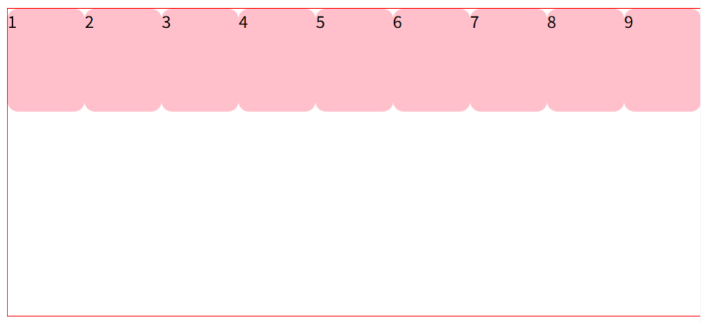

```css
.container {
    display: flex;
    align-items: flex-start;   /* 顶部对齐 */
}
```

**2. flex-end：交叉轴终点对齐（底部）**

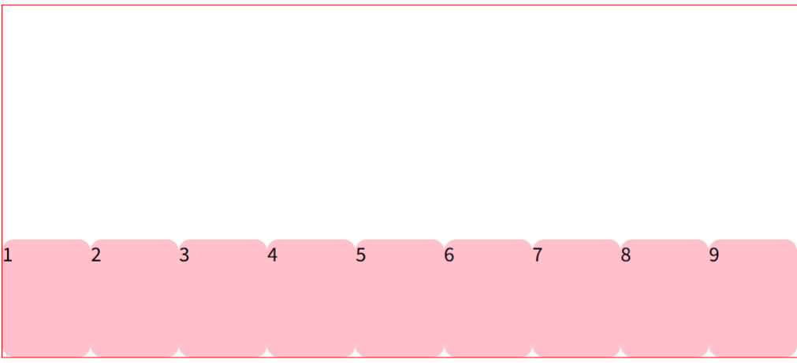

```css
.container {
    display: flex;
    align-items: flex-end;   /* 底部对齐 */
}
```

**3. center：交叉轴居中对齐（最常用）**

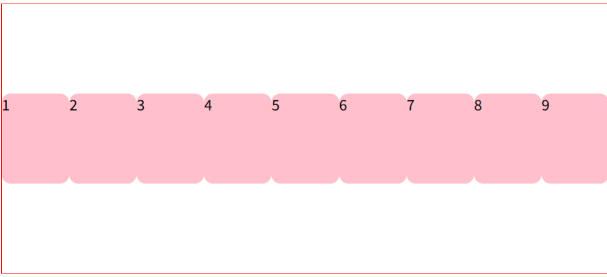

```css
.container {
    display: flex;
    align-items: center;   /* 垂直居中 */
}
```

**4. stretch：拉伸填满整个容器（默认）**

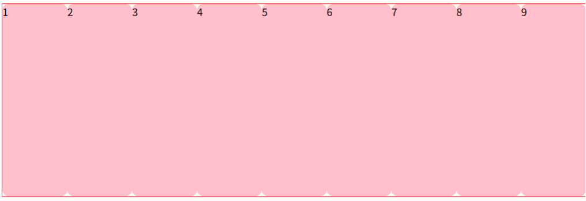

```css
.container {
    display: flex;
    align-items: stretch;   /* 项目无固定高度时拉伸填满 */
}
.container .item {
    width: 100px;
    /* height: 100px; */   /* 高度注释掉，无固定高度 */
    background-color: pink;
    border-radius: 10px;
}
```

#### 4.3.5 flex-wrap —— 是否换行

控制项目在一行排不下时是否换行。

| 属性值 | 效果说明 |
| --- | --- |
| `nowrap`（默认） | **不换行**，全部压缩在一行 |
| `wrap` | **换行**，第一行在上方 |
| `wrap-reverse` | **换行**，第一行在下方（翻转）很少用，了解即可 |

```css
.container {
    display: flex;
    flex-wrap: wrap;   /* 允许换行 */
}
```

#### 4.3.6 align-content —— 多行交叉轴对齐

当 `flex-wrap: wrap` 且**内容换行后有多行**时，控制多行在交叉轴上的分布。

| 属性值 | 效果说明 |
| --- | --- |
| `flex-start` | 多行靠顶部对齐 |
| `flex-end` | 多行靠底部对齐 |
| `center` | 多行垂直居中 |
| `space-between` | 多行两端对齐 |
| `space-around` | 多行两侧间隔相等 |
| `space-evenly` | 多行间隔完全相等 |

**每种对齐方式的示例**

**1. flex-start：多行靠顶部对齐**

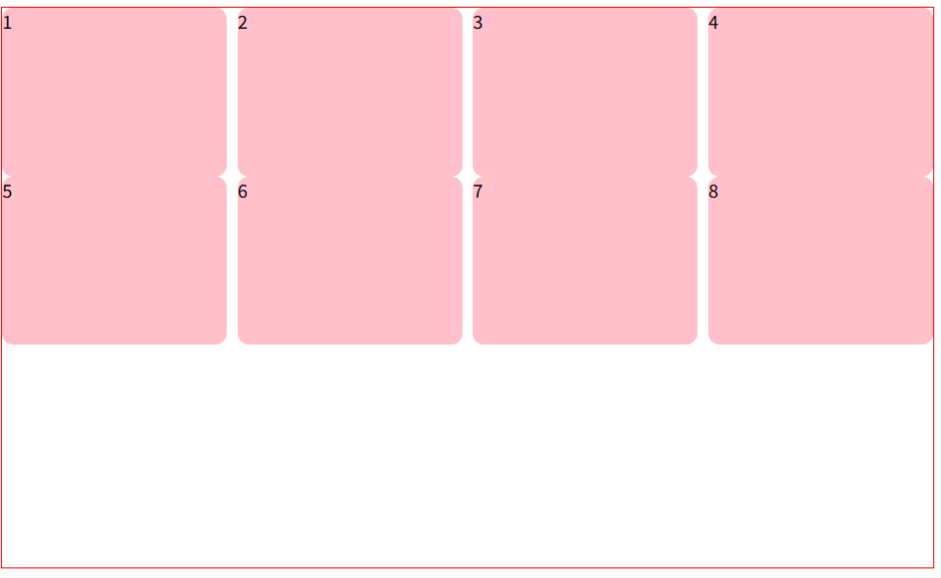

```css
.box {
    display: flex;
    flex-wrap: wrap;
    align-content: flex-start;  /* 多行整体靠顶部 */
    width: 830px;
    height: 500px;              /* 必须要有高度 */
}
```

**2. flex-end：多行靠底部对齐**

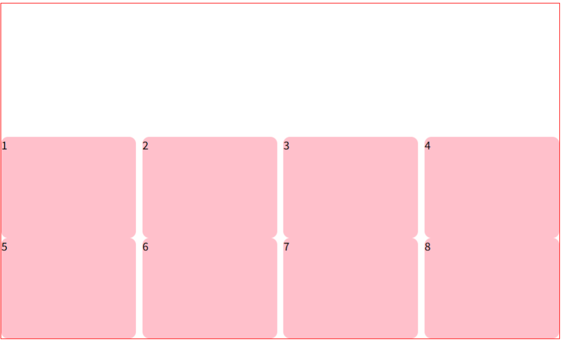

```css
.box {
    display: flex;
    flex-wrap: wrap;
    align-content: flex-end;    /* 多行整体靠底部 */
    width: 830px;
    height: 500px;
}
```

**3. center：多行垂直居中**

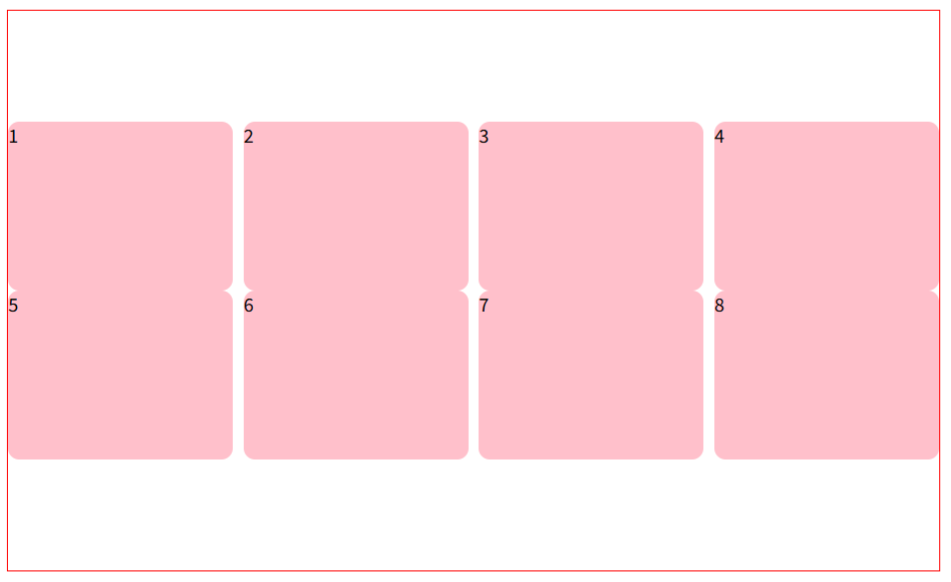

```css
.box {
    display: flex;
    flex-wrap: wrap;
    align-content: center;      /* 多行整体垂直居中 */
    width: 830px;
    height: 500px;
}
```

**4. space-between：多行两端对齐**

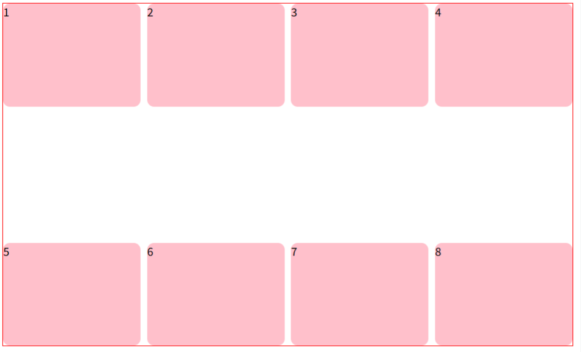

```css
.box {
    display: flex;
    flex-wrap: wrap;
    align-content: space-between; /* 首行贴顶、末行贴底，中间均匀分布 */
    width: 830px;
    height: 500px;
}
```

**5. space-around：多行两侧间隔相等**

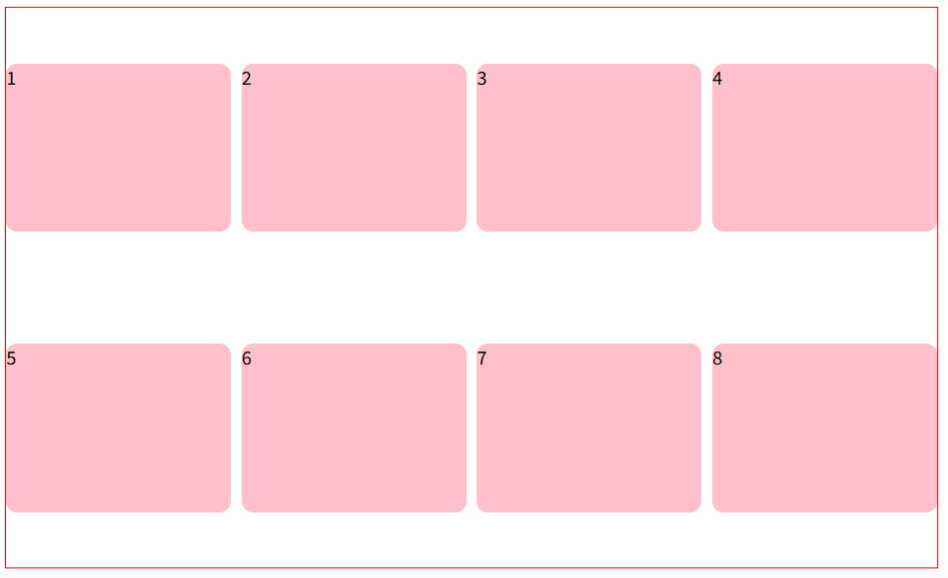

```css
.box {
    display: flex;
    flex-wrap: wrap;
    align-content: space-around;  /* 每行上下间隔相等（边缘间隔是中间的一半） */
    width: 830px;
    height: 500px;
}
```

**6. space-evenly：多行间隔完全相等**

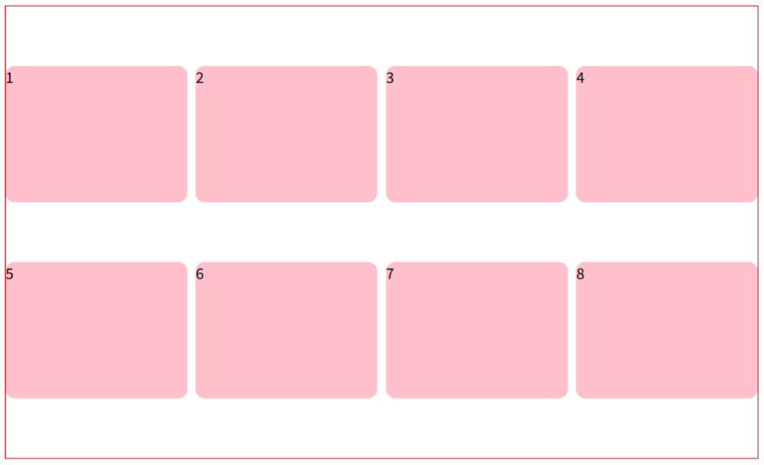

```css
.box {
    display: flex;
    flex-wrap: wrap;
    align-content: space-evenly;  /* 所有间隔完全相等（含边缘） */
    width: 830px;
    height: 500px;
}
```

**关键点**：

- 多行沿着交叉轴对齐，**必须给容器设置高度**，否则没有多余空间可供分布，无法对齐。
- `align-content` 作用于**多行整体**在交叉轴上的分布；`align-items` 作用于**单行内**各项目在交叉轴上的对齐，两者互不冲突。

> **实际开发中**，`align-content` 使用较少，大部分子元素顺序排列即可。

### 4.4 项目（子盒子）属性

#### 4.4.1 flex —— 剩余空间分配

`flex` 是 `flex-grow`、`flex-shrink`、`flex-basis` 的简写，**只控制主轴方向的尺寸**：`flex-basis` 不为 `auto` 时覆盖 `width`，再按 `flex-grow` 分配剩余空间。

**含义**：

- `flex: 1` 等同 `flex: 1 1 0%`：各项目在**主轴方向**（宽度）等分剩余空间；
- 高度占满父盒是 交叉轴 `align-items: stretch`（默认值）拉伸的效果，**与 `flex: 1` 无关**；
- 数值表示**所占份数**（正整数），常用于**等分布局**（如导航栏均分）。

**示例一：每个盒子各占一份（等分）**

四个小盒子都设置 `flex: 1`，份数相同，父容器的剩余空间被平均分成 4 份，每个盒子各占 1 份，实现**等分布局**。

```css
.item {
    flex: 1;              /* 每个小盒子占一份 */
    width: 80px;
    height: 100px;
    background-color: pink;
}
```

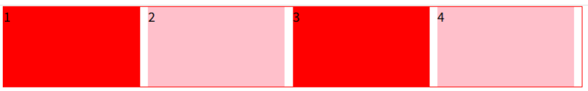

**示例一解析**：

- 四个小盒子都是 `flex: 1`，份数比为 `1 1 1 1`，每个盒子各占剩余空间的 **1/4**，宽度完全一致。

> **flex 要加在子项上**，管的是**主轴**尺寸；

**示例二：其中一个盒子占两份（不等分）**

四个小盒子默认 `flex: 1`，把第三个改为 `flex: 2`，份数变成 `1 1 2 1`，总份数为 5，第三个盒子占据剩余空间的 **2/5**，比其他盒子宽一倍。

```css
.item {
    flex: 1;
    width: 80px;
    height: 100px;
    background-color: pink;
    margin-right: 10px;
}
.item:nth-child(odd) {
    background-color: red;
}
.item:nth-child(3) {
    /* 第三个小盒子占两份，变成 1 1 2 1，于是第三个占据 2/5 */
    /* 具体讲解剩余空间：每个小盒子加上 margin 后，去掉 margin 的数值分配剩余空间 */
    flex: 2;
}
```

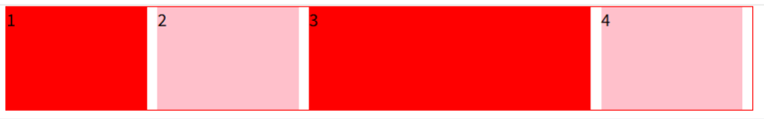

**示例二解析**：

- `flex: 2` 等同 `flex: 2 1 0%`：第三个项目 **`flex-grow` 为 2**，四个项目 grow 比例为 `1:1:2:1`（共 5 份），第三个项目分得剩余空间的 2/5。
- 剩余空间 = 容器内容区宽度 − 各项目 `flex-basis` 之和（此处均为 0）− 各项目 `margin`/`gap` 之和，`margin`、`gap` 越大，可分配的剩余空间越小。

**flex 简写对照表**：

| 写法 | 等效于 | 说明 |
| --- | --- | --- |
| `flex: 1;` | `flex-grow: 1; flex-shrink: 1; flex-basis: 0%;` | 等比放大/收缩，初始无基准 |
| `flex: 2;` | `flex-grow: 2; flex-shrink: 1; flex-basis: 0%;` | 占 2 份空间 |
| `flex: none;` | `flex-grow: 0; flex-shrink: 0; flex-basis: auto;` | 不放大，不缩小 |
| `flex: 0 0 200px;` | 不放大，不缩小，固定 200px | 固定宽度（不换行时） |

#### 4.4.2 其他项目属性

除了 `flex` 简写外，项目（子盒子）还有 5 个常用属性：`flex-grow`、`flex-shrink`、`flex-basis`、`align-self`、`order`。它们分别控制项目的**放大、缩小、初始尺寸、单独对齐和排列顺序**。

| 属性 | 作用 | 默认值 | 示例 |
| --- | --- | --- | --- |
| `flex-grow` | 定义子元素剩余空间分配的**放大比例** | 0（不放大） | `flex-grow: 1;` |
| `flex-shrink` | 定义子元素剩余空间分配的**缩小比例**，空间不足时等比缩小 | 1（等比缩小） | `flex-shrink: 0;`（不缩小） |
| `flex-basis` | 定义项目在主轴方向上的**初始大小**，优先级高于 `width` | auto | `flex-basis: 200px;` |
| `align-self` | 覆盖容器的 `align-items`，单独定义某个项目的**交叉轴对齐方式** | auto（继承容器） | `align-self: center;` |
| `order` | 定义项目的**排列顺序**，数值越小越靠前 | 0 | `order: -1;` |

**1. flex-grow —— 放大比例**

当容器在主轴方向上有**剩余空间**时，`flex-grow` 决定项目如何瓜分这些空间。默认值为 `0`，表示不放大，项目保持自身尺寸。

```css
.item {
    flex-grow: 1;   /* 有剩余空间时，该项目参与瓜分 */
}
```

多个项目同时设置 `flex-grow` 时，按**数值比例**分配剩余空间：

```css
.item1 { flex-grow: 1; }   /* 占 1 份 */
.item2 { flex-grow: 2; }   /* 占 2 份，是 item1 的两倍宽 */
```

**2. flex-shrink —— 缩小比例**

当容器空间**不足**（所有项目总宽度超过容器）时，`flex-shrink` 决定项目如何被压缩。默认值为 `1`，表示空间不足时**等比缩小**；设为 `0` 则**不缩小**，保持自身尺寸。

```css
.item {
    flex-shrink: 0;   /* 空间不足也不压缩，保持原宽 */
}
```
> 典型应用：固定宽度的侧边栏、图标、Logo 等不希望被压缩的元素，设置 `flex-shrink: 0`。

**3. flex-basis —— 主轴初始大小**

定义项目在主轴方向上的**初始大小**，默认值为 `auto`（取 `width`/`height` 或内容尺寸）。一旦设置 `flex-basis`，它的**优先级高于 `width`**。

```css
.item {
    flex-basis: 200px;   /* 主轴初始宽度 200px，覆盖 width */
}
```

**4. align-self —— 单独对齐**

覆盖容器的 `align-items`，**单独定义某个项目**在交叉轴上的对齐方式，不影响其他项目。默认值为 `auto`，表示继承容器的 `align-items` 设置。

```css
.container {
    display: flex;
    align-items: flex-start;   /* 容器默认顶部对齐 */
}
.item {
    align-self: center;        /* 这个项目单独垂直居中 */
}
```

**5. order —— 排列顺序**

定义项目的排列顺序，默认值为 `0`，**数值越小越靠前**。允许使用负数，让某个项目排到最前面。

```css
.item {
    order: -1;   /* 排到所有 order 为 0 的项目前面 */
}
```
```css
.item1 { order: 2; }   /* 排第三 */
.item2 { order: 1; }   /* 排第二 */
.item3 { order: 0; }   /* 排第一（默认） */
```
> **注意**：`order` 只改变**视觉排列顺序**，不改变 HTML 文档中的实际结构，对屏幕阅读器和 SEO 无影响。

### 4.5 gap 间距

`gap` 用于设置容器内相邻项目之间的**间距（沟槽 gutter）**，写在**父容器**上（flex 容器、grid 容器都支持），**不写在子项上**。

**语法**：

```css
.container {
    display: flex;
    gap: 20px;        /* 一个值：行间距、列间距都是 20px */
    gap: 20px 30px;   /* 两个值：row-gap 20px（行间距/纵向）、column-gap 30px（列间距/横向） */
}
```

**等价拆分写法**：

```css
.container {
    row-gap: 20px;     /* 行间距（纵向） */
    column-gap: 30px;  /* 列间距（横向） */
}
```
> `gap` 同样适用于 Grid 布局。

**为什么需要 gap？**

- 过去常用 `margin` 或 `justify-content: space-between` 来制造间距，但 `margin` 会额外占用空间、影响剩余空间分配，`space-between` 又无法精确控制间距大小。**引入 `gap` 后，间距由容器统一管理**，不参与 `flex-grow` 的剩余空间计算，代码更简洁、间距更可控。

#### 4.5.1 gap小结

gap 不是 flex 专属：**Grid 布局、多列布局（multi-column）同样支持**，语法完全一致；

> 经过我们学习后发现，flex 换行后的多行布局（对齐、跨行间距、每行项目数不一致）写起来比较繁琐。原因是：
>
> **flex 是一维布局**：擅长处理**单行或单列**（导航栏、一行按钮、图标+文字纵向排列），简单直接；
>
> **Grid 是二维布局**：处理**多行多列的网格**（商品列表、卡片墙、整体页面框架）时，行列对齐、跨行跨列都很方便；因此，这类场景 Grid 才是最佳选择。

### 4.6 垂直对齐（vertical-align）与图片底部空白缝隙

前面我们学习了 Flex 布局的容器属性和项目属性，掌握了如何用 `justify-content`、`align-items` 等属性控制元素的对齐与分布。但在实际开发中，还有一个非常常见的小问题：图片底部总是多出一截空白缝隙。这一节我们就来彻底解决它。

#### 4.6.1 问题现象

图片默认和文字的**基线（baseline）** 对齐，导致图片底部出现**约 3-5px 的空白缝隙**。

**原因**：行内/行内块元素默认按基线对齐，基线下方保留着字母下行部分（如 `p`、`g` 的下伸部分）的空间。

#### 4.6.2 解决方案

**方案一：将图片转为块级元素**

```css
img {
    display: block;  /* 消除基线对齐的影响 */
}
```

**方案二：修改 vertical-align 属性**

| 属性值 | 效果 |
| --- | --- |
| `baseline`（默认） | 基线对齐（有缝隙） |
| `top` | 顶部对齐 |
| `middle` | 中部对齐 |
| `bottom` | 底部对齐（**无缝隙**） |

```css
img {
    vertical-align: middle;  /* 或 top / bottom */
}
```

**方案三：父元素 font-size: 0（不推荐）**

```css
.parent {
    font-size: 0;  /* 消除空白字符影响，但会影响子元素文字 */
}
```

#### 4.6.3 用 vertical-align 让文字和图片垂直居中

实际开发中做导航栏【图标 + 文字】时，`vertical-align: middle` 还顺带让图标和旁边文字在视觉上居中对齐，一举两得。

**示例：让文字和图片垂直居中**

```html
<div class="nav-item">
    
    <span>心选秒杀</span>
</div>
```
> 默认情况下，图片和文字按**基线**对齐，文字底部会多出一截下行部分，看起来不整齐。

给图片加上 `vertical-align: middle` 后，**图片的中部与文字的中部对齐**，两者在视觉上就自然居中了：

```css
img {
  border: 0;
  vertical-align: middle;  /* 让图片和旁边文字垂直居中 */
}
```

- 早期浏览器中，被 `<a>` 链接包裹的图片会自动加一条蓝色（访问后变紫色）边框。`border: 0` 用来去掉它。现代浏览器默认已不显示，但作为重置样式保留已成习惯。

**使用时有两点要注意：**

- `vertical-align` 只作用于写了该属性的那个行内元素本身；父元素设置无效——给装图片的 `div` 写 `vertical-align: middle` 不会让图片居中，必须写在 `img` 自己身上。
- 在 flex / Grid 布局中，子项作为**弹性项目**参与布局，图片底部缝隙问题通常不再出现，垂直对齐交给 `align-items` 即可。
