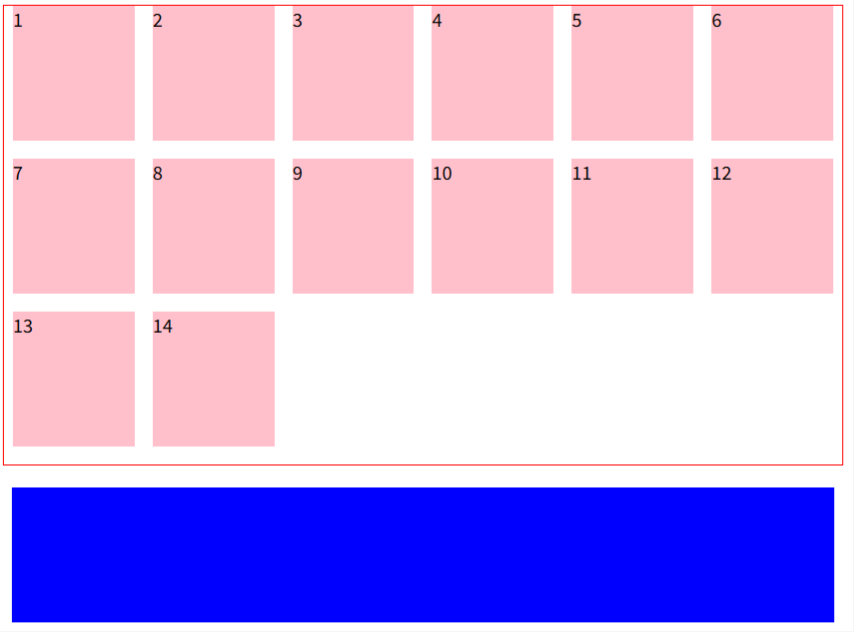

# 实战：淘宝多行弹性布局（负 margin + padding 栅格）

> 原文：[CSDN](https://blog.csdn.net/qq_63283852/article/details/164758085)

**摘要**：本文详解实现淘宝首页多行商品卡片墙的完整流程：通过四层结构（.w版心、.box弹性容器、.item栅格格子、.content卡片）逐层解决布局问题。核心技巧为：用`flex:0 0 16.66666%`确保每行6个卡片自动换行，`padding:0 8px`实现16px缝隙，`margin:0 -8px`抵消首尾内边距使卡片贴齐版心边缘，配合`border-box`盒模型与负边距实现精准对齐。

---

写这段代码之前，我们先需要理清楚需求。要做的是淘宝首页那种**多行商品卡片墙**，核心就一个诉求：**每行卡片之间有统一缝隙，但首尾卡片要贴齐版心边缘**。



下面按**真实的写代码顺序**来还原：

## 一、动手过程（边写边改）

#### 第一步：先写 HTML

先把盒子和格子写出来。于是有了 `.box`（容器）和 `.item`（格子），先写 若干个 item 占位。

```html
<div class="box">
  <div class="item">1</div>
  <div class="item">2</div>
  <div class="item">3</div>
  <!-- ... 14 个 item -->
</div>
```

#### 第二步：给 .box 写 CSS，让它横排 + 换行

这里的关键是让 `.box` 里的格子横向排列，放不下时自动换行。

> 注意：`flex-wrap: wrap` 只是**允许**换行，真正会不会换行，取决于 item 的宽度基准。

```css
.box {
  display: flex;      /* 横着排 */
  flex-wrap: wrap;    /* 放不下就换行 */
}
```

#### 第三步：给 .item 写 CSS，先写 flex: 1，我们发现问题

如果 `.item` 里写 `flex: 1`，格子仍然会挤在一行不换行。

为什么？

因为 `flex: 1` 是 `flex: 1 1 0%` 的缩写，`flex-basis` 是 0。

关键在换行判定发生在拉伸之前：浏览器先按每个格子的**基准宽度（flex-basis）**判断一行放不放得下——`flex-basis: 0%` 意味着每个格子基准宽度算 0，14 个格子加起来还是 0，浏览器判定"一行完全放得下"，于是全部排进同一行；之后 `flex-grow: 1` 才把整行空间平分拉满。所以换行永远不会触发。

```css
.item {
  flex: 1;   /* 等价于 flex: 1 1 0%，basis 为 0 → 总宽 0 → 永不换行，grow 再拉满整行 */
}
```

#### 第四步：改成 flex: 0 0 16.66666%，这才换行

这是淘宝布局的关键：`flex` 三个值分别是 `flex-grow`、`flex-shrink`、`flex-basis`，基准值相对于父亲的百分比。写死 `flex-basis: 16.66666%`（1/6），6 个格子基准之和 = 100%，第 7 个超出一行，才会掉行。

> **换行看的是 basis 之和超不超 100%，跟 grow/shrink 无关——**这里不采用固定像素宽度（比如 80px），因为固定像素无法随容器自适应拉伸，必须用百分比基准，因此这里必须用百分比基准。

```css
.item {
  /* flex 三个值：flex-grow flex-shrink flex-basis（基准值，相对父亲的百分比） */
  flex: 0 0 16.66666%;   /* 6 个格子 basis 之和 = 100%，第 7 个超一行 → 换行 */
  height: 120px;
}
```

#### 第五步：发现卡片顶满屏幕了

页面内容不能顶满整个浏览器宽度，得有个"版心"把内容框在中间、限个宽度。于是外面再套一层 `.w`，负责"整体居中、限宽"。如果只在 `.box` 上加 margin，无法保证左右对齐，所以额外套一个 `.w` 盒子，确保内容在版心内移动。

```html
<div class="w">
  <div class="box">
    <div class="item">1</div>
    <div class="item">2</div>
    <!-- ... 14 个 item -->
  </div>
</div>
```
```css
.w {
  width: 80%;
  margin: 20px auto;
}
```

#### 第六步：发现缝隙和背景错位

卡片之间需要有 16px 的缝，这是设计稿上和商品页需要的间距数据。

第一反应是给每个格子加右外边距：

```css
.item {
  margin-right: 16px;   /* 想让卡片之间空 16px，先试试 margin */
}
```

刷新一看，第 6 个格子被挤到第二行了。因为 margin 控制盒子**外面**，第 6 个格子算上自己的 16px 右边距，总宽度超了一行。想留住就得写 `.item:nth-child(6n) { margin-right: 0 }` 把每行最后一个的边距清掉——但是新的问题出现：换行后每行的第六位还会变，非常难以优雅控制。

那就换 padding，padding 可以在盒子内部增加距离：

```css
.item {
  padding: 0 8px;
}
```

左边卡片让出 8px、右边卡片让出 8px，拼起来正好是 16px。

刷新：缝呢？？粉色还是糊成一片。

背景色在 item 上，而 padding 区也是 item 的一部分，背景色体现不出留白。

这才发现 item 一个盒子无法完成同时用 padding 留白，同时保证背景颜色。于是我们就拆成两层，各司其职：`.item` 只管站位和留白；`.content` 套在 item 里面，背景在它身上。

> 注意：`padding: 0 8px` 处理，靠开头重置里的 `box-sizing: border-box` 来控制。

```html
<div class="w">
  <div class="box">
    <div class="item">
      <div class="content">1</div>
    </div>
    <div class="item">
      <div class="content">2</div>
    </div>
    <!-- ... 14 个 item -->
  </div>
</div>
```
```css
.item {
  flex: 0 0 16.66666%;
  height: 120px;
  margin-bottom: 16px;   /* 行间距 */
  padding: 0 8px;        /* 左右各 8px = 槽宽的一半 */
}

.item .content {
  width: 100%;
  height: 100%;
  background-color: pink;   /* 背景画在 content 上，缝隙才露得出来 */
}
```

#### 第七步之前：设置一个 footer 来观测是否与下面页面对齐

```html
<div class="footer"></div>
```
```css
.footer {
  width: 80%;
  height: 20px;
  margin: 0 auto;
  background-color: #ccc;
}
```

#### 第七步：发现首尾对不齐，用负 margin 修正

因为每个 item 有 `padding: 0 8px`，第一个 item 的卡片会缩进 8px，和版心对不齐。于是给 `.box` 加 `margin: 0 -8px`，向左右各外扩 8px，抵消首尾的内边距。这是负 margin 在栅格布局中的核心应用。

> 注意前提：`margin: 0 -8px` 能成立，是因为 `.w` 只占 80% 宽、两侧有大量空余，外扩 8px 不会顶到屏幕边；如果版心是 100% 宽，负 margin 会让内容超出视口、可能出现横向滚动条。

```css
.box {
  display: flex;
  flex-wrap: wrap;
  margin-left: -8px;    /* 负边距：抵消首尾 item 的 padding */
  margin-right: -8px;
}
```

所以最终结构出现：

```html
<div class="w">              <!-- 第1层：版心，负责"整体居中、限宽" -->
  <div class="box">          <!-- 第2层：flex容器，负责"横排+换行" -->
    <div class="item">       <!-- 第3层：栅格格子，负责"占多宽、留缝隙" -->
      <div class="content">1</div>  <!-- 第4层：真正可见的卡片 -->
    </div>
    ... 14 个 item
  </div>
</div>
<div class="footer"></div>   <!-- 底部灰色条，用来验证对齐 -->
```

顺序就是：**版心(w) → 弹性盒(box) → 格子(item) → 卡片(content)**。下面按这个思路，一层一层讲每一层到底在解决什么问题。

## 二、逐层分析

#### 第1层 .w —— 版心

```css
.w {
  width: 80%;
  margin: 20px auto;
}
```

页面内容不顶满屏幕，而是占 80% 宽、左右居中（`margin: auto`），这就是"版心"。注意它**没有 padding**，对齐问题全部交给下一层处理。

#### 第2层 .box —— flex 容器

```css
.box {
  display: flex;
  flex-wrap: wrap;          /* 关键①：允许换行 */
  margin-left: -8px;        /* 关键②：负边距 */
  margin-right: -8px;
}
```

- `flex-wrap: wrap`：一行放不下就掉到第二行。没有这句，14 个格子塞在一行；
- `margin: 0 -8px`：向左右各"伸出"8px，作用是抵消首尾格子的内边距。

#### 第3层 .item —— 栅格格子（重点）

```css
.item {
  flex: 0 0 16.66666%;      /* 关键：每个格子占 1/6 宽，一行 6 个 */
  height: 120px;
  margin-bottom: 16px;      /* 行与行之间的间距 */
  padding: 0 8px;           /* 左右各 8px 内边距 = 槽宽的一半 */
}
```

**`flex: 0 0 16.66666%` 三个数的含义**：

- `flex-grow: 0`——不拉伸；
- `flex-shrink: 0`——不收缩（挤不下直接换行）；
- `flex-basis: 16.66666%`——基准宽度 = 父盒子的 1/6（100 ÷ 6）。

三个数合起来：**每个格子严格占 1/6 宽**，第 7 个自动掉行。

**`padding: 0 8px` 是缝隙的来源**：格子本身不画背景，左右各留 8px 内边距，相邻两个格子的 padding 拼起来 = 16px 缝隙。

**`margin-bottom: 16px`**：制造行间距（老写法，现在可以用 `row-gap: 16px` 替代）。

#### 第4层 .content —— 卡片

```css
.item .content {
  width: 100%;
  height: 100%;
  background-color: pink;
}
```

item 的 padding 区域没有背景色，缝隙才能露出来。

## 三、核心技巧：负 margin 为什么能让首尾贴齐？

假设版心 `.w` 宽 600px：

**加上 `margin: 0 -8px` 后：**

- `.box` 向左右各外扩 8px，可用宽度变成 616px；
- 第一个 item 从外扩后的起点开始排，它的 `padding-left: 8px` 刚好把卡片推回到版心边缘
- 右边同理。

而中间的缝隙不受影响：相邻格子之间仍然是 8px + 8px = 16px。

**padding 负责中间有缝，负 margin 负责首尾对齐**，两个配合实现栅格布局。
